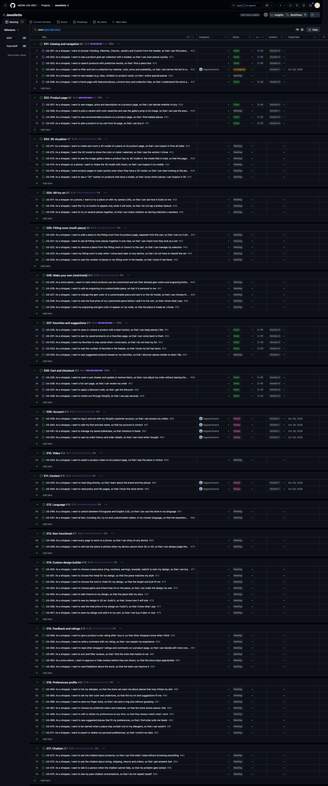

# Retrospective - Iteration 0

## Did Well

* Seamless E-Commerce Integrations: Successfully established integration with Shopify and Shopify Hydrogen.

* Quality User Stories: Authored well-defined user stories with clear scopes and user value.

* Granular Task Decomposition: Effectively broke user stories down into manageable tasks for better tracking.

* Organized GitHub Board: Kept the GitHub project board structured, up-to-date, and visually transparent for the entire team.

## Do Differently

* Optimize Work Distribution: Improve how tasks are assigned and balanced across all team members to prevent individual bottlenecks.

## Puzzles

* Shopify Purchase: We are unsure whether a user will be able to finish a purchase.
* Deploy: Lack of access to the needed tool to deploy.

## Board at the end of Sprint 0

